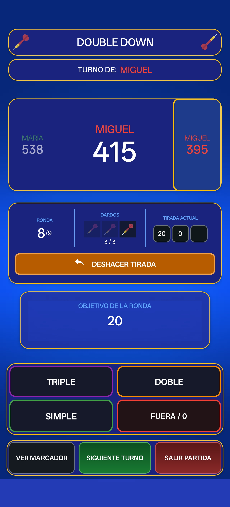
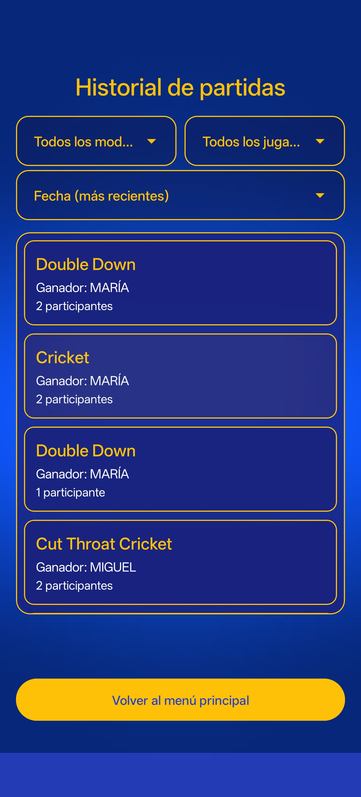
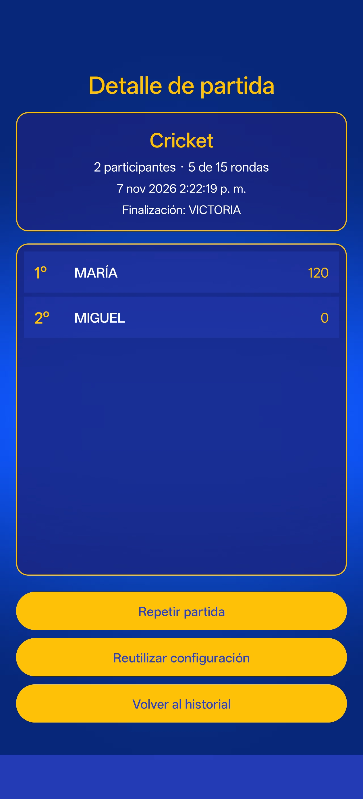
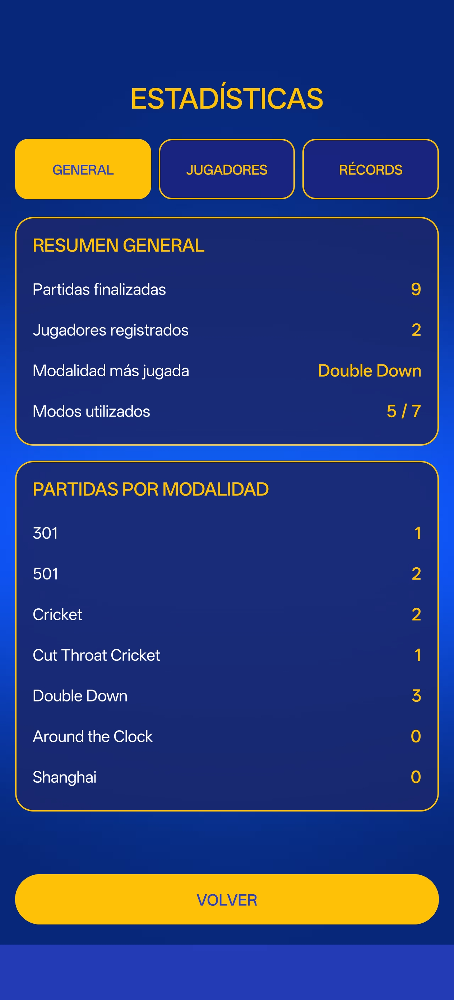
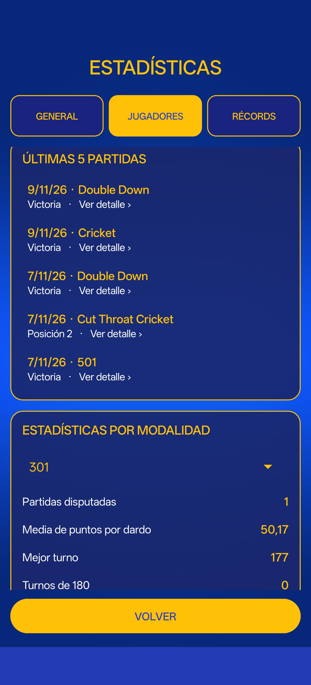

# Sistema de Gestión de Partidas de Dardos

Aplicación móvil para **Android**, desarrollada en **Java**, que permite organizar y disputar partidas de dardos en siete modalidades, controlar automáticamente las puntuaciones y consultar el historial y las estadísticas de los jugadores.

El proyecto se ha realizado como **Proyecto Final del Ciclo Formativo de Grado Superior en Desarrollo de Aplicaciones Multiplataforma (DAM)**.

**Tecnologías principales:** Java · Android SDK · XML · SQLite · SharedPreferences · AndroidX · Material Components · Gradle.

## Estado del proyecto

La aplicación dispone de las funcionalidades principales implementadas y probadas: gestión de jugadores, configuración de partidas, siete modos de juego, reanudación y deshacer, resultados, historial y estadísticas.

Actualmente se encuentra en **fase de revisión final, documentación y preparación para una posible distribución en Google Play**. No se presenta como una aplicación ya publicada en la tienda.

## Funcionalidades

- **Jugadores:** creación, edición, asignación de colores y activación o desactivación sin perder sus resultados históricos.
- **Configuración:** selección de modalidad y participantes, número de rondas y dardos por turno, reglas opcionales, orden aleatorio y reutilización de la última configuración.
- **Partidas:** registro de lanzamientos, multiplicadores, marcadores y objetivos; control automático de turnos y aplicación de las reglas de cada modalidad.
- **Continuar y deshacer:** recuperación de una partida en curso y reversión de lanzamientos durante el juego.
- **Resultados:** ganador, clasificación final y posibilidad de disputar una revancha.
- **Historial:** consulta y filtrado de partidas finalizadas, acceso a su detalle y reutilización de configuraciones anteriores. Incluye opciones para ocultar y restaurar partidas en el listado.
- **Estadísticas:** resúmenes generales, información por jugador y mejores marcas, calculadas a partir de los datos de las partidas guardadas.
- **Navegación:** menú principal y lateral, ajustes, reglas, ayuda y sección «Acerca de».

## Modalidades de juego

| Modalidad | Descripción |
|---|---|
| **301** | Cada jugador comienza con 301 puntos y debe llegar exactamente a cero. Puede exigirse cierre con doble. |
| **501** | Misma mecánica que 301, comenzando con 501 puntos. |
| **Cricket** | Cerrar los objetivos del 20 al 15 y el Bull, con puntuación según las marcas y objetivos abiertos. |
| **Cut Throat Cricket** | Variante de Cricket en la que se asignan puntos a los rivales y se busca terminar con la menor puntuación. |
| **Double Down** | Nueve rondas con objetivos determinados; una ronda sin aciertos penaliza reduciendo la puntuación a la mitad. |
| **Around the Clock** | Recorrer los objetivos del 1 al 20 y el Bull; dobles y triples permiten avanzar más. |
| **Shanghai** | Conseguir puntos en cada ronda sobre su objetivo correspondiente, aplicando multiplicadores. |

## Capturas de pantalla

Capturas reales de la aplicación ejecutada en un dispositivo Android. Se muestran distintas fases de una partida y las pantallas de consulta de resultados.

### Inicio, configuración y partida de puntos

<p align="center">
  
  
  
</p>
<p align="center"><sub>Menú principal · Configuración · Partida 301/501</sub></p>

### Otras modalidades y clasificación

<p align="center">
  
  
  
</p>
<p align="center"><sub>Cricket · Double Down · Resultados finales</sub></p>

### Historial de partidas

<p align="center">
  
  
</p>
<p align="center"><sub>Historial · Detalle de partida</sub></p>

### Estadísticas

<p align="center">
  
  
</p>
<p align="center"><sub>Resumen general · Estadísticas individuales</sub></p>

> También se conservan otras capturas en [`docs/capturas/`](docs/capturas/), útiles para la memoria técnica y la defensa del proyecto.

## Arquitectura y almacenamiento

La aplicación separa **interfaz**, **lógica de juego** y **acceso a datos**:

- Las **Activities** gestionan la interacción y la navegación.
- Los **modelos y estados de partida** representan jugadores, puntuaciones, turnos, resultados y datos estadísticos.
- Las clases **DAO (Data Access Object)** encapsulan el acceso a SQLite, evitando consultas directas desde las Activities.
- Las **clases auxiliares** gestionan configuraciones, serialización y recuperación de partidas.

### SQLite

La base de datos local se estructura en cuatro tablas relacionadas:

| Tabla | Responsabilidad |
|---|---|
| `JUGADORES` | Identidad del jugador, nombre normalizado, color y estado activo/inactivo. |
| `PARTIDAS` | Datos generales de las partidas finalizadas y configuración asociada. |
| `RESULTADOS_PARTIDA` | Posición, puntuación y orden de participación de cada jugador. |
| `ESTADISTICAS_PARTIDA` | Contadores y estadísticas individuales obtenidos en cada partida. |

El guardado definitivo de partidas, resultados y estadísticas se realiza al **finalizar una partida**, mediante operaciones transaccionales. Las partidas abandonadas no se incorporan al historial. Las estadísticas agregadas se calculan desde los registros históricos, sin duplicar acumulados en `JUGADORES`.

### SharedPreferences

Se utiliza `SharedPreferences` para los **ajustes**, la **última configuración** y el **estado de la partida en curso**, de modo que esta pueda reanudarse. Las configuraciones históricas se almacenan junto con las partidas en SQLite, mediante una representación JSON.

## Requisitos e instalación

- **Plataforma:** Android 9 (API 28) o superior.
- **Entorno de desarrollo:** Android Studio y el sistema de compilación Gradle del proyecto.
- **Configuración Android:** `compileSdk = 36` y `targetSdk = 36`.
- **Almacenamiento:** local, sin necesidad de configurar un servidor o una base de datos externa.

Para ejecutar el proyecto:

1. Clona o descarga el repositorio, si tienes acceso a él.
2. Ábrelo en **Android Studio** y sincroniza las dependencias con Gradle.
3. Selecciona un emulador o dispositivo Android compatible.
4. Ejecuta la configuración **app**.

## Pruebas y validación

A lo largo del desarrollo se han realizado pruebas **unitarias**, **instrumentadas** y **manuales**. Entre las comprobaciones se incluyen las reglas de los siete modos, deshacer, continuar, revancha, almacenamiento en SQLite, integridad de datos y navegación entre pantallas.

Como evidencia del proceso de validación, se registró una ejecución satisfactoria de **101 pruebas instrumentadas** en un emulador Android. Las pruebas continúan formando parte de las revisiones del proyecto.

Comandos habituales de Gradle desde la raíz del repositorio:

```bash
./gradlew :app:assembleDebug
./gradlew :app:testDebugUnitTest
./gradlew :app:connectedDebugAndroidTest
```

> En Windows, también pueden ejecutarse con `gradlew.bat`. Las pruebas instrumentadas requieren un emulador o dispositivo conectado.

La revisión final contempla análisis con **Android Lint**, comprobaciones de compatibilidad y preparación de una compilación para pruebas de Google Play. Ninguna de estas comprobaciones debe interpretarse como una certificación integral de seguridad.

## Privacidad y tratamiento de datos

Los datos de jugadores, partidas, resultados y estadísticas se almacenan localmente en el dispositivo. La aplicación no incorpora cuentas de usuario, publicidad ni un sistema propio de envío de estos datos a servidores del desarrollador. Las copias de seguridad o transferencias realizadas por Android dependen de la configuración del dispositivo.

**[Consultar la política de privacidad](https://melero95.github.io/Sistema-de-Gestion-de-Partidas-de-Dardos/)**.

## Metodología y evolución del proyecto

El desarrollo se ha organizado en fases progresivas: diseño y configuración, reglas y pantallas de juego, integración de SQLite, recuperación de estados, historial, estadísticas, pruebas y revisión final.

Se ha utilizado **Git y GitHub** para registrar cambios mediante commits, facilitar la detección de regresiones y documentar la evolución técnica y visual. El [historial de commits](https://github.com/melero95/Sistema-de-Gestion-de-Partidas-de-Dardos/commits/main) permite consultar este proceso.

### Uso de inteligencia artificial

La inteligencia artificial se ha utilizado como herramienta de apoyo durante el proyecto. En las primeras etapas se empleó principalmente para resolver dudas, explorar alternativas y planificar tareas; posteriormente también intervino de forma sustancial en la **generación y modificación de código**, la depuración, las pruebas y la documentación.

El desarrollador ha definido los requisitos, valorado alternativas, tomado decisiones sobre reglas y diseño, propuesto cambios propios y revisado las soluciones mediante pruebas. El trabajo combina decisiones y supervisión humanas con el uso explícito de herramientas de IA.

## Posibles mejoras futuras

- Ampliación de idiomas y adaptación de la interfaz a orientación horizontal.
- Nuevos modos, variantes por parejas y opciones de configuración avanzadas.
- Filtros y comparativas adicionales de estadísticas.
- Asistentes de cierre o recomendaciones de lanzamiento.
- Evaluación de versiones Lite/Pro y posibles modelos de monetización.
- Distribución en **Google Play**, si se completan los requisitos y pruebas correspondientes.

Estas ideas son propuestas de evolución, no funcionalidades que se presenten como ya implementadas.

## Autor

**Luis Melero** · [GitHub: @melero95](https://github.com/melero95)

Proyecto Final del CFGS de **Desarrollo de Aplicaciones Multiplataforma (DAM)**, realizado como parte de mi formación y portfolio de desarrollo Android.
