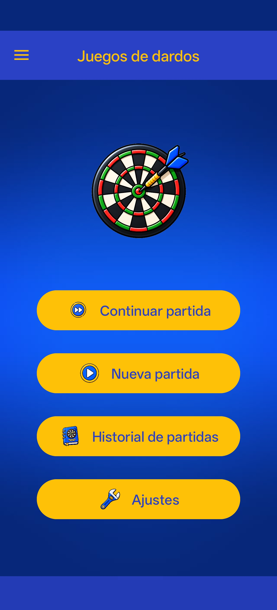
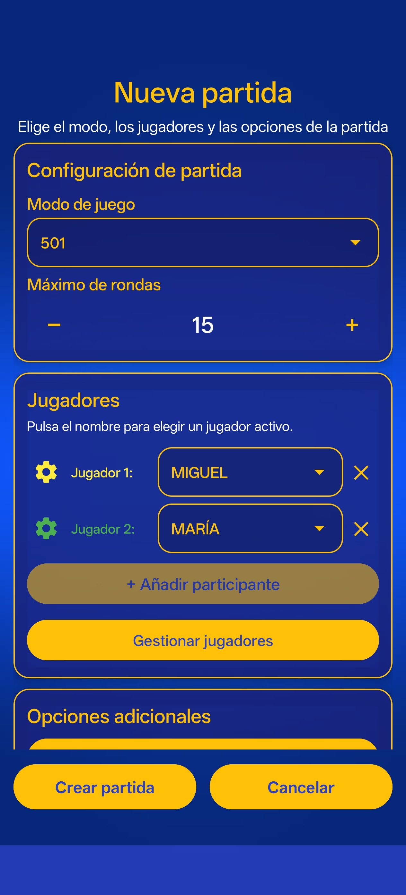
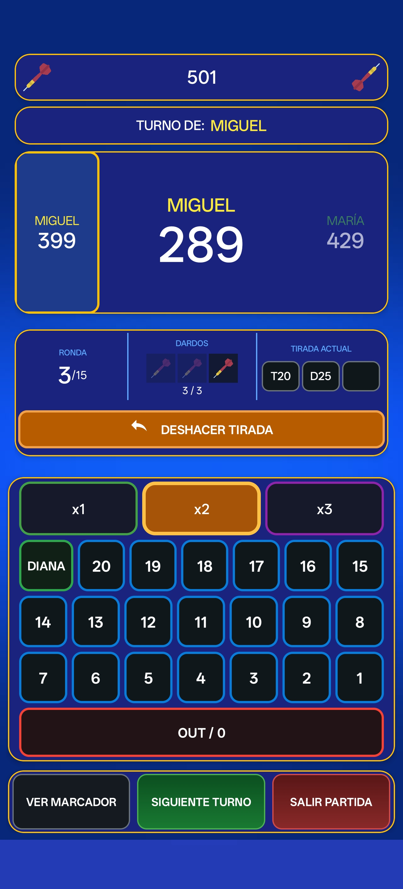
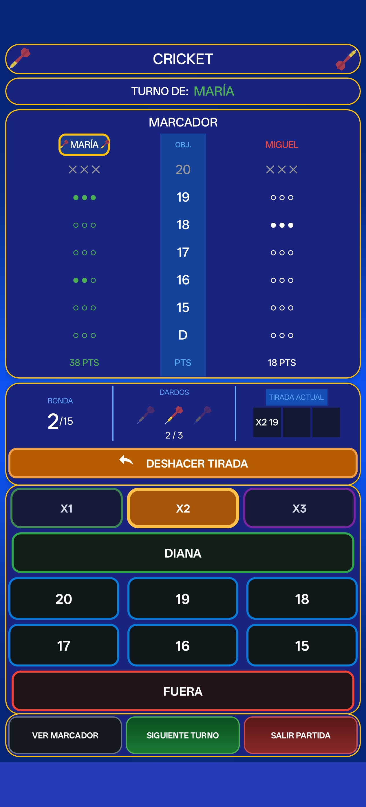
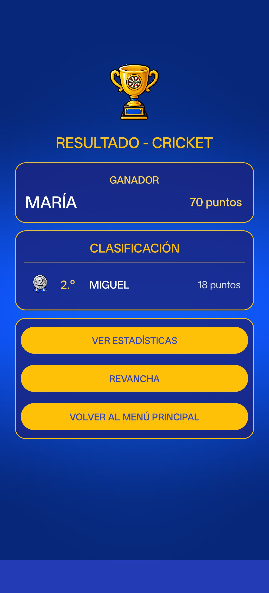

# Sistema de Gestión de Partidas y Estadísticas de Dardos

Aplicación móvil desarrollada en **Java para Android**, destinada a la gestión de partidas de dardos en diferentes modalidades de juego.

La aplicación permite configurar partidas con varios jugadores, gestionar las puntuaciones y turnos, aplicar las reglas específicas de cada modalidad y consultar los resultados obtenidos.

El proyecto incorpora un sistema de persistencia local mediante **SQLite**, diseñado para almacenar jugadores, partidas finalizadas, resultados y estadísticas, complementado con `SharedPreferences` para gestionar las preferencias y las partidas en curso.

### Objetivos del proyecto

- Desarrollar una aplicación Android funcional e intuitiva para gestionar partidas de dardos.
- Implementar diferentes modalidades con sus correspondientes reglas.
- Gestionar jugadores, configuraciones, puntuaciones y resultados.
- Aplicar persistencia de datos mediante SQLite y SharedPreferences.
- Desarrollar una arquitectura organizada que facilite el mantenimiento y las futuras ampliaciones.
- Documentar el proceso de desarrollo y su evolución mediante Git y GitHub.

El proyecto se desarrolla como **Proyecto Final del Ciclo Formativo de Grado Superior en Desarrollo de Aplicaciones Multiplataforma (DAM)**.

## Estado actual del proyecto

**Estado: En desarrollo.**

La aplicación cuenta actualmente con siete modalidades de juego implementadas, un sistema de configuración de partidas, gestión de jugadores, control de puntuaciones, resultados finales y mecanismos para continuar partidas, deshacer tiradas e iniciar revanchas.

Se ha implementado una base de datos local SQLite, con acceso mediante clases DAO, que permite gestionar jugadores y almacenar las partidas finalizadas junto con sus resultados y estadísticas individuales.

El desarrollo se realiza de manera progresiva, incorporando nuevas funcionalidades y realizando pruebas para comprobar su correcto funcionamiento y evitar regresiones.

### Funcionalidades actualmente en desarrollo

- Historial de partidas finalizadas y consulta de sus detalles.
- Visualización de estadísticas individuales y generales.
- Consultas de récords y mejores resultados.
- Pruebas de integración, revisión de casos especiales y mejoras de la interfaz.
- Auditoría de calidad, seguridad y preparación para su posible distribución mediante Google Play.

La aplicación se encuentra en una etapa funcional avanzada, aunque todavía no se considera una versión finalizada ni preparada para su publicación.

## Funcionalidades principales

La aplicación incorpora distintas funcionalidades para gestionar partidas de dardos desde su configuración inicial hasta la obtención de los resultados.

### Gestión de jugadores

- Creación y edición de jugadores.
- Asignación de colores personalizados.
- Activación y desactivación de jugadores sin eliminar sus datos históricos.
- Selección de participantes para nuevas partidas, evitando duplicados.

### Configuración de partidas

- Selección de modalidad y número de jugadores.
- Configuración de rondas y dardos por turno.
- Ajustes específicos, como cierre con doble y mantenimiento del multiplicador.
- Posibilidad de establecer un orden aleatorio de participación.
- Recuperación de la última configuración utilizada.

### Desarrollo de las partidas

- Registro de lanzamientos y aplicación de multiplicadores.
- Actualización de puntuaciones y marcadores.
- Gestión de turnos, rondas y objetivos.
- Aplicación automática de las reglas de cada modalidad.
- Posibilidad de deshacer lanzamientos y continuar partidas guardadas.

### Resultados y persistencia

- Visualización del ganador y la clasificación final.
- Inicio de revanchas manteniendo la configuración.
- Almacenamiento de partidas finalizadas en SQLite.
- Registro de resultados y estadísticas individuales de los participantes.

### Navegación y personalización

- Menú principal y menú lateral de navegación.
- Pantallas de ajustes, reglas, ayuda y acerca de.
- Interfaz personalizada con colores, iconos y componentes visuales adaptados a la aplicación.

## Modos de juego

La aplicación incluye **siete modalidades de dardos**, cada una con sus propias reglas de puntuación, objetivos y condiciones de finalización.

- **301:** modalidad de puntuación descendente en la que los jugadores comienzan con 301 puntos y deben llegar exactamente a cero, con posibilidad de exigir cierre mediante doble.
- **501:** comparte las reglas del 301, pero comienza con 501 puntos.
- **Cricket:** consiste en cerrar los objetivos del 20 al 15 y el Bull, acumulando puntos según los objetivos que permanezcan abiertos.
- **Cut Throat Cricket:** variante de Cricket en la que los puntos se asignan a los rivales, buscando finalizar con la menor puntuación.
- **Double Down:** modalidad de nueve rondas con objetivos específicos, donde los fallos completos de una ronda provocan que la puntuación se reduzca a la mitad.
- **Around the Clock:** carrera de objetivos desde el 1 hasta el Bull, con avances adicionales al conseguir dobles o triples.
- **Shanghai:** modalidad de puntuación por rondas, con un número objetivo diferente en cada una y puntos según los multiplicadores obtenidos.

## Tecnologías utilizadas

El proyecto se ha desarrollado utilizando las siguientes tecnologías y herramientas:

| Tecnología | Utilización |
|---|---|
| **Java** | Lenguaje principal de desarrollo y lógica de la aplicación. |
| **Android SDK** | Desarrollo de funcionalidades y componentes Android. |
| **XML** | Diseño de interfaces, recursos y estilos visuales. |
| **SQLite** | Almacenamiento local de jugadores, partidas, resultados y estadísticas. |
| **SharedPreferences** | Gestión de preferencias, configuraciones y partidas en curso. |
| **AndroidX y Material Components** | Componentes de interfaz, navegación y diseño. |
| **Gradle** | Configuración, dependencias y compilación del proyecto. |
| **Git y GitHub** | Control de versiones y seguimiento del desarrollo. |

**Entorno de desarrollo:** Android Studio.

## Arquitectura y persistencia de datos

La aplicación está organizada en diferentes clases y paquetes, separando la interfaz de usuario, la lógica de juego, los modelos de datos y los mecanismos de persistencia.

### Organización del proyecto

- **Activities:** gestionan las pantallas y la interacción del usuario.
- **Modelos:** representan jugadores, partidas, resultados, estadísticas y estados de juego.
- **DAO (Data Access Object):** encapsulan las operaciones de acceso a SQLite, evitando realizar consultas SQL directamente desde las Activities.
- **Clases auxiliares:** gestionan configuraciones, serialización de datos y recuperación de estados de partida.

### Base de datos SQLite

La aplicación utiliza una base de datos SQLite local compuesta por cuatro tablas relacionadas:

| Tabla | Función |
|---|---|
| `JUGADORES` | Almacena los jugadores registrados, sus nombres, colores y estado activo o inactivo. |
| `PARTIDAS` | Registra las partidas finalizadas, su modalidad, fecha, ganador y configuración. |
| `RESULTADOS_PARTIDA` | Almacena la clasificación y puntuación de cada participante. |
| `ESTADISTICAS_PARTIDA` | Guarda las estadísticas individuales obtenidas en cada partida. |

Las partidas finalizadas se almacenan mediante operaciones transaccionales para mantener la integridad de los datos.

Las estadísticas históricas se obtienen a partir de los registros almacenados, evitando duplicar estadísticas acumuladas en la tabla de jugadores.

### SharedPreferences

Se utiliza `SharedPreferences` para almacenar información que no requiere persistencia histórica en SQLite:

- Preferencias y ajustes predeterminados.
- Última configuración utilizada.
- Estado de la partida en curso para permitir su reanudación.

Esta separación permite mantener los datos históricos en SQLite y gestionar de forma independiente la configuración y las partidas activas.

## Capturas de pantalla

A continuación se muestran algunas de las principales pantallas de la aplicación, incluyendo la configuración de partidas, las diferentes interfaces de juego y la presentación de resultados.

*Las capturas corresponderán a la versión de la aplicación documentada en este repositorio.*

<!--
Añade las imágenes a docs/capturas/ con estos nombres y elimina las marcas de comentario
para mostrar la galería en GitHub.

  
  
  

  
  

-->

## Instalación y ejecución

El proyecto puede descargarse o clonarse desde este repositorio y abrirse directamente en **Android Studio**.

Una vez sincronizadas las dependencias mediante Gradle, la aplicación puede ejecutarse en un emulador o dispositivo físico con **Android 9 (API 28) o superior**.

La aplicación utiliza SQLite como base de datos local, por lo que no requiere configurar servidores ni servicios externos.

## Pruebas y validaciones

Durante el desarrollo se realizan pruebas automatizadas y manuales para verificar el correcto funcionamiento de la aplicación y detectar posibles errores tras incorporar nuevas funcionalidades.

Entre las principales comprobaciones se encuentran:

- **Pruebas unitarias:** validación de componentes y lógica de funcionamiento.
- **Pruebas instrumentadas:** ejecución de tests en un emulador Android para comprobar componentes y operaciones de persistencia.
- **Pruebas funcionales:** verificación de las reglas de las distintas modalidades, puntuaciones, turnos y condiciones de finalización.
- **Pruebas de persistencia:** comprobación del almacenamiento de jugadores, partidas, resultados y estadísticas en SQLite.
- **Pruebas de regresión:** revisión de funcionalidades existentes, como deshacer tiradas, continuar partidas y comenzar revanchas.

Las pruebas se realizan progresivamente durante el desarrollo, utilizando las herramientas de Android Studio y Gradle.

Antes de considerar finalizada la aplicación, están previstas revisiones adicionales de compatibilidad, rendimiento y seguridad.

## Metodología de desarrollo y control de versiones

El desarrollo de la aplicación se realiza de manera progresiva, incorporando nuevas funcionalidades y mejoras sobre una base funcional existente.

Durante este proceso se han llevado a cabo tareas de planificación, implementación, pruebas, corrección de errores y refactorización, revisando el funcionamiento de la aplicación después de cada conjunto de cambios.

Para gestionar la evolución del proyecto se utilizan **Git y GitHub**, registrando los cambios realizados mediante commits.

El historial del repositorio permite consultar la incorporación de funcionalidades, las modificaciones de la interfaz, las mejoras de la lógica de juego y la evolución del sistema de persistencia.

Este enfoque facilita el seguimiento del desarrollo, la identificación de cambios y el mantenimiento del código.

## Escalabilidad y mejoras futuras

La aplicación se ha desarrollado con una estructura que permite incorporar nuevas funcionalidades y ampliar las capacidades existentes.

Entre las posibles líneas de evolución del proyecto se contemplan:

### Ampliaciones funcionales

- Incorporación de nuevos idiomas, como inglés, francés y portugués.
- Adaptación de la interfaz a orientación horizontal.
- Incorporación de nuevos modos de juego y variantes, incluyendo partidas por parejas y modalidades aleatorias.
- Posibilidad de modificar determinados ajustes durante una partida.
- Sistema de sugerencias de lanzamiento para facilitar el cierre de partidas.
- Ampliación de los filtros del historial y herramientas para comparar estadísticas entre jugadores.

### Versiones y monetización

- Estudio de una posible versión **Lite**, con funcionalidades básicas, y una versión **Pro**, con características adicionales.
- Evaluación de diferentes modelos de monetización, como el desbloqueo de funcionalidades mediante una versión Pro o la inclusión de publicidad no intrusiva.

### Validación y distribución

- Preparación de la aplicación para su evaluación mediante **Google Play Console**, utilizando herramientas de pruebas e informes previos al lanzamiento para detectar posibles problemas de estabilidad, compatibilidad y rendimiento.
- Revisión de los requisitos de calidad, seguridad y privacidad necesarios para una posible distribución.
- Posible publicación de la aplicación en **Google Play Store**, inicialmente como versión gratuita, con la posibilidad de incorporar posteriormente otros modelos de distribución o monetización.

Las comprobaciones de Google Play no equivalen a una certificación integral de seguridad. Estas propuestas representan posibles ampliaciones futuras y no constituyen funcionalidades implementadas ni compromisos de desarrollo.

## Uso de inteligencia artificial

La utilización de herramientas de inteligencia artificial ha evolucionado progresivamente durante el desarrollo del proyecto, adaptándose a sus necesidades y a su creciente complejidad.

En las primeras etapas, la IA se utilizó principalmente como herramienta de consulta, generación de ideas, planteamiento de alternativas y apoyo en la resolución de dudas técnicas.

A medida que el proyecto fue creciendo, su participación aumentó, incorporándose a tareas de generación y modificación de código, integración de funcionalidades, revisión del flujo de la aplicación, detección y corrección de errores, elaboración de pruebas y documentación.

Durante este proceso, el desarrollador ha intervenido en la definición de requisitos, la elección de alternativas, las decisiones de diseño y arquitectura, la propuesta de modificaciones y la comprobación del funcionamiento de las soluciones implementadas.

De esta manera, el proyecto refleja una colaboración progresiva entre el desarrollador y las herramientas de IA, combinando la toma de decisiones y supervisión humana con el apoyo de la inteligencia artificial en tareas cada vez más complejas.

## Autor

**Luis Melero**

Proyecto desarrollado como parte del **Proyecto Final del Ciclo Formativo de Grado Superior en Desarrollo de Aplicaciones Multiplataforma (DAM)**.

La aplicación forma parte de mi formación y portfolio personal como desarrollador de software, con el objetivo de aplicar y ampliar conocimientos en desarrollo Android, programación Java, bases de datos y diseño de aplicaciones móviles.

**GitHub:** [@melero95](https://github.com/melero95)
